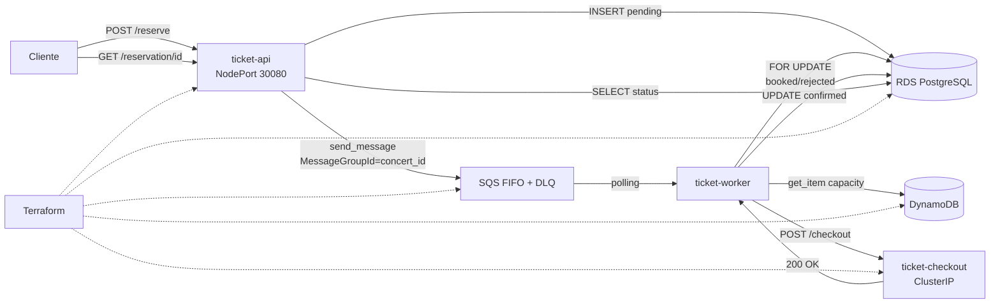

# Concertpass: sistema de reservación de boletos

Concertpass es un sistema de reservación de boletos para conciertos compuesto por tres microservicios desplegados en un cluster EKS de AWS. El sistema recibe solicitudes de compra, las procesa en orden por concierto mediante SQS FIFO, y garantiza que no se venda más del aforo disponible usando una transacción con `FOR UPDATE` en PostgreSQL.

- `ticket-api`: recibe `POST /reserve`, inserta la reservación en RDS con estado `pending`, encola el mensaje en SQS FIFO con `MessageGroupId=concert_id` y expone `GET /reservation/{id}`.
- `ticket-worker`: consume SQS FIFO, consulta la capacidad del concierto en DynamoDB, calcula la disponibilidad en RDS con `FOR UPDATE`, actualiza a `booked` o `rejected`, y confirma con `ticket-checkout` para pasar a `confirmed`.
- `ticket-checkout`: simula el procesador de pagos; `POST /checkout` responde 200 OK y el worker actualiza a `confirmed`.
Los tres servicios tienen Dockerfile, imagen publicada en Amazon ECR y manifiesto de Kubernetes en `k8s/`.

## Nota sobre la estructura del repositorio

La estructura difiere ligeramente del layout sugerido en el enunciado:

- Los scripts viven en `apps/scripts/` (no en `scripts/` en la raíz).
- Los servicios están bajo `apps/` (`apps/ticket-api/`, etc.).

Esta organización se adoptó desde el inicio del proyecto y se mantiene para no romper rutas ya configuradas por todo el equipo (Dockerfiles, manifiestos, comandos documentados abajo). Todos los comandos de este README usan las rutas reales del repositorio.

## Arquitectura


## Recursos

Terraform crea EKS con dos nodos administrados, sus addons CNI/CoreDNS/kube-proxy, PostgreSQL RDS privado, Secrets Manager, SQS FIFO con DLQ, DynamoDB con dos conciertos precargados y tres repositorios ECR. Utiliza dos subredes de la VPC predeterminada y reutiliza `LabRole` para EKS y EC2, tal como esta configurado en AWS Academy. No modifica ni elimina la VPC ni los roles existentes.

El cluster se administra con Terraform, incluido su teardown. La identidad que crea el cluster recibe acceso administrador a Kubernetes. Los pods usan las credenciales temporales del rol del nodo mediante IMDSv2; este esquema del laboratorio comparte los permisos de `LabRole` entre pods. No se generan llaves AWS para los servicios.

RDS acepta el puerto 5432 solamente desde el security group del cluster. El API usa NodePort 30080; `api_allowed_cidr` permite restringir su entrada. Checkout usa ClusterIP y el worker no publica puertos. Los probes TCP funcionan con los servicios actuales sin exigir nuevos endpoints.

## Herramientas y credenciales

Se requieren Terraform >= 1.5, AWS CLI, kubectl y Python >= 3.9. Docker Desktop con contenedores Linux se necesita solamente para construir y publicar imagenes. Los scripts no requieren paquetes Python adicionales ni jq.

```powershell
aws sts get-caller-identity
python apps/scripts/infrastructure.py setup
```

El setup muestra el plan y solicita la confirmacion de Terraform. Crea los recursos, guarda un kubeconfig en `infra/.generated/`, inyecta la configuracion y el Secret de RDS, espera los dos nodos Ready y ejecuta un Job que crea la tabla `reservations` e indice. No despliega aplicaciones automaticamente. Para configurar Kubernetes sobre recursos ya creados: `python apps/scripts/infrastructure.py setup --configure-only`.

Tambien se puede usar Bash:

```bash
bash apps/scripts/setup.sh
```

La region, version de Kubernetes, tipos de instancia, roles y CIDR de acceso se configuran en `infra/variables.tf`; pueden sobreescribirse mediante un archivo local `infra/terraform.tfvars`, que esta ignorado por Git. El estado Terraform y sus planes contienen datos sensibles y tambien se excluyen de Git. No se deben compartir credenciales por el repositorio.

## Variables para los servicios

El ConfigMap `runtime-config` entrega `AWS_REGION`, `AWS_DEFAULT_REGION`, `SQS_QUEUE_URL`, `EVENTS_TABLE`, `CHECKOUT_URL` y `PGSSLMODE=require`. `CHECKOUT_URL` es la URL base interna de checkout; el servicio que lo consume agrega su ruta `/checkout`. El Secret `database` entrega `DB_HOST`, `DB_PORT`, `DB_NAME`, `DB_USER` y `DB_PASSWORD` al API y al worker. El setup obtiene estos valores de Secrets Manager y los envia a Kubernetes por stdin, sin escribirlos en archivos ni argumentos de procesos.

Los valores de capacidad se precargan mediante Terraform en DynamoDB. Publicar mensajes FIFO con `MessageGroupId=concert_id`, decidir inventario y actualizar estados son responsabilidades del codigo de los servicios.

## Imagenes y manifiestos

Publica las imagenes de los servicios con un tag nuevo:

```powershell
python apps/scripts/infrastructure.py images --tag entrega-01
python apps/scripts/infrastructure.py deploy --tag entrega-01
```

## Scripts de escenarios y evidencia

Todos en `apps/scripts/`. Requieren la infraestructura creada (`setup`) y los pods desplegados (`deploy`).

| Script | Uso |
|---|---|
| `lib.sh` | Funciones compartidas (no se ejecuta directamente). |
| `evidence.sh` | Evidencia para el video: `rds`, `dynamodb`, `sqs`, `sqs-demo`, `reset`, `all`. |
| `scenario-niche.sh` | Escenario de poca demanda: las 4 reservas terminan `confirmed`. |
| `scenario-high-demand.sh` | Escenario de alta demanda con `--workers 3` por defecto: envia 60 reservas de `vip` (capacidad 50) y verifica que no hay sobreventa. |
| `verify-teardown.sh` | Confirma con AWS CLI que `teardown.sh` elimino todos los recursos. |

Ciclo completo para la demostracion:

```bash
bash apps/scripts/evidence.sh reset --yes
bash apps/scripts/evidence.sh sqs-demo
bash apps/scripts/scenario-niche.sh
bash apps/scripts/scenario-high-demand.sh
bash apps/scripts/evidence.sh all
bash apps/scripts/teardown.sh --auto-approve
bash apps/scripts/verify-teardown.sh
```

## Comprobar infraestructura

```powershell
python apps/scripts/infrastructure.py validate
python apps/scripts/infrastructure.py status
$env:KUBECONFIG = "$PWD/infra/.generated/kubeconfig"
kubectl get nodes
kubectl -n concertpass get pods,services
```

Validate exige exactamente dos nodos Ready, ejecuta un Job que comprueba el acceso del pod a SQS y DynamoDB, y valida contra el API de Kubernetes los tres manifiestos de aplicaciones mediante dry-run. El Job de setup demuestra la conexion de los pods a RDS y la estructura de la tabla. Esta comprobacion no valida la logica de reservaciones; para eso estan los scripts de escenarios descritos arriba.

Para consumir el API se usa `http://IP_PUBLICA_DE_UN_NODO:30080` despues de desplegar su imagen. Status muestra las direcciones de los nodos.

## Escenarios de prueba

El sistema se valida con dos escenarios que cubren los extremos del comportamiento esperado:

- **Concierto de nicho** (`artista-nicho-cdmx`, capacidad `general = 8`): 4 reservas de 1 boleto. Todas terminan en `confirmed`. `scenario-niche.sh` lo ejecuta y verifica el resultado.
- **Concierto de alta demanda** (`bad-bunny-gdl`, capacidad `vip = 50`): 60 reservas de 1 boleto con 3 replicas del worker. Las primeras 50 terminan en `booked`/`confirmed`; las 10 restantes en `rejected`. `scenario-high-demand.sh` lo ejecuta y verifica que no hay sobreventa (vendidos <= capacidad).

El video de demostracion sigue este orden: `evidence.sh sqs-demo` (muestra el mensaje en SQS con su `MessageGroupId`), `scenario-niche.sh`, `scenario-high-demand.sh`, `evidence.sh all` (estado en RDS, DynamoDB y SQS), `teardown.sh`, y `verify-teardown.sh` (confirma que no quedan recursos).

## Eliminar recursos

```powershell
python apps/scripts/infrastructure.py teardown
```

```bash
bash apps/scripts/teardown.sh
```

Se elimina el namespace y Terraform solicita confirmacion antes de destruir sus recursos. Esto borra los datos de RDS/DynamoDB, los mensajes y las imagenes ECR del stack. Los scripts setup y teardown aceptan `--auto-approve` para un ciclo automatizado autorizado. EKS, nodos y RDS generan cargos mientras permanezcan creados; la validacion acordada para este trabajo termina con teardown.

Los resultados del ciclo real de creacion, despliegue, validacion y eliminacion estan en [infra/VALIDATION.md](infra/VALIDATION.md).
