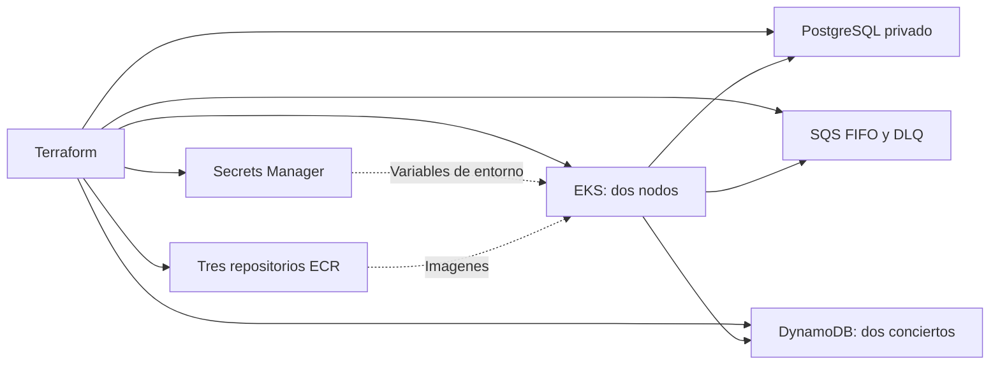

# Concertpass: infraestructura

Este cambio administra infraestructura AWS, despliegue y manifiestos Kubernetes. El codigo de `ticket-api` y `ticket-checkout` se conserva como esta en Git; `ticket-worker` corresponde al responsable de ese servicio.



## Recursos

Terraform crea EKS con dos nodos administrados, sus addons CNI/CoreDNS/kube-proxy, PostgreSQL RDS privado, Secrets Manager, SQS FIFO con DLQ, DynamoDB con dos conciertos precargados y tres repositorios ECR. Utiliza dos subredes de la VPC predeterminada y reutiliza `LabRole` para EKS y EC2, tal como esta configurado en AWS Academy. No modifica ni elimina la VPC ni los roles existentes.

El cluster se administra con Terraform, incluido su teardown. La identidad que crea el cluster recibe acceso administrador a Kubernetes. Los pods usan las credenciales temporales del rol del nodo mediante IMDSv2; este esquema del laboratorio comparte los permisos de `LabRole` entre pods. No se generan llaves AWS para los servicios.

RDS acepta el puerto 5432 solamente desde el security group del cluster. El API usa NodePort 30080; `api_allowed_cidr` permite restringir su entrada. Checkout usa ClusterIP y el worker no publica puertos. Los probes TCP funcionan con los servicios actuales sin exigir nuevos endpoints.

## Herramientas y credenciales

Se requieren Terraform >= 1.5, AWS CLI, kubectl y Python >= 3.9. Docker Desktop con contenedores Linux se necesita solamente para construir y publicar imagenes. Los scripts no requieren paquetes Python adicionales ni jq.

```powershell
aws sts get-caller-identity
python apps/scripts/infrastructure.py setup
```

El setup muestra el plan y solicita la confirmacion de Terraform. Crea los recursos, guarda un kubeconfig en `infra/.generated/`, inyecta la configuracion y el Secret de RDS, espera los dos nodos Ready y ejecuta un Job que crea la tabla `reservations` e indice. No despliega aplicaciones automaticamente. Para configurar Kubernetes sobre recursos ya creados: `python apps/scripts/infrastructure.py setup --configure-only`.

Tambien se puede usar Bash:

```bash
bash apps/scripts/setup.sh
```

La region, version de Kubernetes, tipos de instancia, roles y CIDR de acceso se configuran en `infra/variables.tf`; pueden sobreescribirse mediante un archivo local `infra/terraform.tfvars`, que esta ignorado por Git. El estado Terraform y sus planes contienen datos sensibles y tambien se excluyen de Git. No se deben compartir credenciales por el repositorio.

## Variables para los servicios

El ConfigMap `runtime-config` entrega `AWS_REGION`, `AWS_DEFAULT_REGION`, `SQS_QUEUE_URL`, `EVENTS_TABLE`, `CHECKOUT_URL` y `PGSSLMODE=require`. `CHECKOUT_URL` es la URL base interna de checkout; el servicio que lo consume agrega su ruta `/checkout`. El Secret `database` entrega `DB_HOST`, `DB_PORT`, `DB_NAME`, `DB_USER` y `DB_PASSWORD` al API y al worker. El setup obtiene estos valores de Secrets Manager y los envia a Kubernetes por stdin, sin escribirlos en archivos ni argumentos de procesos.

Los valores de capacidad se precargan mediante Terraform en DynamoDB. Publicar mensajes FIFO con `MessageGroupId=concert_id`, decidir inventario y actualizar estados son responsabilidades del codigo de los servicios.

## Imagenes y manifiestos

Publica las imagenes de los servicios que ya tienen Dockerfile con un tag nuevo:

```powershell
python apps/scripts/infrastructure.py images --tag entrega-01 --services ticket-api ticket-checkout
python apps/scripts/infrastructure.py deploy --tag entrega-01 --services ticket-api ticket-checkout
```

Cuando el equipo tenga el worker completo, puede publicar y desplegar los tres omitiendo `--services`. Los tags ECR son inmutables; cada publicacion debe utilizar un tag distinto. Deploy comprueba que existan todas las imagenes solicitadas antes de modificar Kubernetes, reemplaza `REPLACE_IMAGE` en los manifiestos y espera sus rollouts. No se debe aplicar directamente un Deployment que aun contenga ese marcador.

En Bash estan disponibles `apps/scripts/publish_images.sh` y `apps/scripts/deploy.sh` con los mismos argumentos. El worker tiene una replica; se puede escalar temporalmente a tres con `kubectl -n concertpass scale deployment/ticket-worker --replicas=3` cuando su imagen este disponible.

## Comprobar infraestructura

```powershell
python apps/scripts/infrastructure.py validate
python apps/scripts/infrastructure.py status
$env:KUBECONFIG = "$PWD/infra/.generated/kubeconfig"
kubectl get nodes
kubectl -n concertpass get pods,services
```

Validate exige exactamente dos nodos Ready, ejecuta un Job que comprueba el acceso del pod a SQS y DynamoDB, y valida contra el API de Kubernetes los tres manifiestos de aplicaciones mediante dry-run. El Job de setup demuestra la conexion de los pods a RDS y la estructura de la tabla. Esta comprobacion no valida la logica de reservaciones ni reemplaza las pruebas de los responsables de los servicios.

Para consumir el API se usa `http://IP_PUBLICA_DE_UN_NODO:30080` despues de desplegar su imagen. Status muestra las direcciones de los nodos.

## Eliminar recursos

```powershell
python apps/scripts/infrastructure.py teardown
```

```bash
bash apps/scripts/teardown.sh
```

Se elimina el namespace y Terraform solicita confirmacion antes de destruir sus recursos. Esto borra los datos de RDS/DynamoDB, los mensajes y las imagenes ECR del stack. Los scripts setup y teardown aceptan `--auto-approve` para un ciclo automatizado autorizado. EKS, nodos y RDS generan cargos mientras permanezcan creados; la validacion acordada para este trabajo termina con teardown.

Los resultados del ciclo real de creacion, despliegue, validacion y eliminacion estan en [infra/VALIDATION.md](infra/VALIDATION.md).
